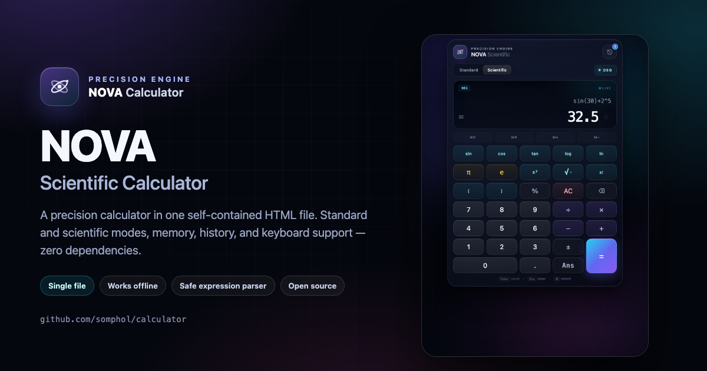

<div align="center">



# NOVA — Scientific Calculator

**One file. Zero dependencies. No network. A precision calculator that feels like an app.**

[](https://github.com/somphol/calculator/actions/workflows/verify.yml)
[](https://github.com/somphol/calculator/actions/workflows/deploy.yml)
[](https://github.com/somphol/calculator/releases)
[](LICENSE)
[](scientific-calculator.html)
[](scientific-calculator.html)

**[Try the live demo →](https://somphol.github.io/calculator/)**

</div>

---

## Why NOVA?

Most web calculators are either a toy or a pile of frameworks. NOVA is a complete,
keyboard-friendly scientific calculator that ships as **one self-contained HTML file**.
There is no build step, no package manager, no CDN, and no telemetry. Download it,
open it, and it works — online or offline, today or in ten years.

The expression engine is a hand-written recursive-descent parser. It never calls
`eval()` or `new Function()`, so pasted text is treated as math, not code.

## Screenshots

| Standard mode | Scientific mode |
| :---: | :---: |
|  |  |

## Features

- **Two keypads** — a focused standard layout and a five-column scientific layout.
- **Safe expression parser** — recursive descent with correct precedence, unary operators,
  right-associative powers, postfix factorial and percent, and implicit multiplication.
- **Scientific functions** — `sin`, `cos`, `tan`, `log`, `ln`, `sqrt`, powers, factorial,
  constants `π` and `e`, and degree/radian switching.
- **Memory that survives reloads** — `MC`, `MR`, `M+`, and `M−`, persisted with `localStorage`.
- **History drawer** — keeps the last 60 calculations; reuse either the expression or its result.
- **Keyboard-first** — type numbers and operators, use `Enter` to solve, `Backspace` to delete,
  and single-letter shortcuts for functions and constants.
- **Copy result** — one click copies a clean, plain-text value to the clipboard.
- **Thoughtful formatting** — grouping separators, scientific notation for extreme values,
  and tidy trig results around zero.
- **Accessible by design** — semantic buttons, visible focus rings, an ARIA live result,
  labelled controls, and a keyboard-dismissable history dialog.
- **Responsive glassmorphism UI** — tuned for desktop, tablet, and small phones, with
  reduced visual weight at short viewport heights.
- **Zero runtime dependencies** — no fonts, scripts, images, or styles fetched from the network.

## Quick start

```bash
git clone https://github.com/somphol/calculator.git
cd calculator
open scientific-calculator.html        # macOS
# xdg-open scientific-calculator.html  # Linux
# start scientific-calculator.html     # Windows
```

You can also [download the HTML file](https://raw.githubusercontent.com/somphol/calculator/main/scientific-calculator.html)
and double-click it. That is the entire installation.

Prefer a local server? Any static server works:

```bash
python3 -m http.server 8080
# then visit http://localhost:8080/scientific-calculator.html
```

## Keyboard shortcuts

| Key | Action |
| --- | --- |
| `0`–`9`, `.` | Enter digits and a decimal point |
| `+` `-` `*` `/` `^` `!` `%` `(` `)` | Insert an operator |
| `Enter` or `=` | Evaluate the expression |
| `Backspace` | Delete the last character |
| `Delete` or `Esc` | Clear everything |
| `S` / `C` / `T` | Insert `sin(`, `cos(`, `tan(` |
| `L` / `G` / `R` | Insert `ln(`, `log(`, `sqrt(` |
| `P` | Insert `π` |
| `E` | Insert Euler's number `e` |
| `A` | Insert the previous answer (`Ans`) |

## Expression syntax

| Syntax | Meaning | Example | Result |
| --- | --- | --- | --- |
| `+` `-` `*` `/` | Arithmetic | `1 + 2 * 3` | `7` |
| `^` | Power (right-associative) | `2 ^ 3 ^ 2` | `512` |
| `!` | Factorial | `5!` | `120` |
| `%` | Percent (postfix) | `200 * 10%` | `20` |
| `(` `)` | Grouping | `(1 + 2) * 3` | `9` |
| implicit product | Multiplication by adjacency | `2(3 + 4)` | `14` |
| `sin( )` `cos( )` `tan( )` | Trigonometry in the active angle mode | `sin(30)` | `0.5` |
| `log( )` / `ln( )` | Base-10 / natural logarithm | `log(1000)` | `3` |
| `sqrt( )` | Square root | `sqrt(81)` | `9` |
| `π` or `pi` | Pi | `2π` | `6.283…` |
| `e` | Euler's number | `ln(e)` | `1` |

Pressing `=` automatically closes any unbalanced opening parentheses, and unary minus
works as expected: `-2^2` is `-4`, while `(-2)^2` is `4`.

Errors are explicit and friendly: division by zero, invalid factorials, out-of-domain
logarithms, mismatched parentheses, and unknown symbols all produce a human-readable
message instead of `NaN` or a silent failure.

## How it works

The application is a single HTML document with three parts:

1. **Presentation** — CSS variables define the glass surfaces, accents, spacing, and
   responsive breakpoints. No CSS framework is used.
2. **Parser** — `tokenize()` normalizes symbols (`×`, `÷`, `−`, `π`) and produces tokens.
   A recursive-descent `Parser` handles precedence, unary operators, powers, postfix
   operators, functions, constants, and implicit multiplication.
3. **Interface** — a small state object keeps the expression, angle mode, memory, history,
   and last answer. UI events and keyboard events feed the same mutation helpers, and
   `localStorage` persists preferences between visits.

The parser lives between `/* ===== SAFE PARSER START ===== */` and
`/* ===== SAFE PARSER END ===== */`. The verification script extracts exactly that
block and runs it in isolation, so the tested code is the code that ships.

### Project layout

```text
.
├── scientific-calculator.html      # The entire application
├── scripts/
│   └── verify.mjs                  # Dependency-free structure + parser tests
├── docs/
│   ├── social-card.png             # Repository / social preview
│   ├── screenshot-standard.png
│   └── screenshot-scientific.png
├── .github/
│   ├── workflows/
│   │   ├── verify.yml              # CI: verify on pushes and pull requests
│   │   └── deploy.yml              # CD: publish to GitHub Pages
│   ├── ISSUE_TEMPLATE/
│   ├── dependabot.yml
│   └── PULL_REQUEST_TEMPLATE.md
├── CHANGELOG.md
├── CODE_OF_CONDUCT.md
├── CONTRIBUTING.md
├── LICENSE
├── README.md
├── SECURITY.md
├── robots.txt                      # Deployed with the site
└── sitemap.xml                     # Deployed with the site
```

## Verification

The verifier has no dependencies and runs on Node.js 18+ or Deno:

```bash
node scripts/verify.mjs

# or, with Deno
deno run --allow-read scripts/verify.mjs
```

It performs **60 checks** covering:

- self-containment: no external scripts, stylesheets, fonts, media, or network APIs;
- safety: no `eval()` or `new Function()` in the shipped application;
- document structure: metadata, unique IDs, referenced DOM nodes, button types, both keypads;
- parser behaviour: precedence, associativity, unary operators, implicit multiplication,
  constants, functions in degrees and radians, auto-closing parentheses, and 18 error cases.

The same command runs in CI on every push and pull request.

## Deployment

Pushes to `main` run the verifier and deploy through GitHub Pages. The workflow copies
`scientific-calculator.html` to `_site/index.html` and publishes the artifact, so the
live site stays a single file while keeping the descriptive filename in the repository.

Live site: **<https://somphol.github.io/calculator/>**

## Browser support

NOVA targets the current versions of Chrome, Edge, Firefox, and Safari. It uses modern
CSS (`backdrop-filter`, `color-scheme`, `dvh`) and relies on graceful visual degradation
where a feature is unavailable. JavaScript must be enabled.

## Contributing

Contributions are welcome — bug reports, feature ideas, accessibility improvements, and
documentation fixes alike. Please read [CONTRIBUTING.md](CONTRIBUTING.md) and the
[Code of Conduct](CODE_OF_CONDUCT.md) before opening a pull request. Release history is
kept in [CHANGELOG.md](CHANGELOG.md).

- **Found a bug?** [Open a bug report](https://github.com/somphol/calculator/issues/new?template=bug_report.yml)
- **Have an idea?** [Request a feature](https://github.com/somphol/calculator/issues/new?template=feature_request.yml)
- **Found a vulnerability?** Please follow [SECURITY.md](SECURITY.md) and report it privately.

## License

Released under the [MIT License](LICENSE) © 2026 Somphol Boonjing.

<div align="center">
  <sub>Built with vanilla HTML, CSS, and JavaScript. No frameworks were harmed.</sub>
</div>
